# 🎓 EduPredict — Big Data Educational Analytics & Predictive System

<p align="center">
  
</p>

<p align="center">
  
  
  
  
  
</p>

---

## 📌 Executive Summary

Modern higher-education institutions face critical institutional challenges, including declining student retention rates, suboptimal resource allocation, and delayed intervention for underperforming students. 

**EduPredict** is an end-to-end Big Data Educational Analytics and Predictive Intelligence platform. By synthesizing academic performance records, attendance histories, learning management system (LMS) engagement telemetry, and course demand patterns, EduPredict equips university executives, department heads, and faculty with proactive, data-driven decision-making tools.

---

## 🎯 Key Objectives

- **Early Warning Dropout Detection**: Identify students at risk of academic failure or withdrawal before semester finals.
- **Academic Performance Benchmarking**: Analyze GPA distribution, subject-level pass/fail trends, and cohort comparisons.
- **LMS Engagement Telemetry**: Quantify digital platform interaction (logins, quiz submissions, assignment turn-ins) against academic outcomes.
- **Course Demand Forecasting**: Assist academic departments in curriculum planning, classroom capacity allocation, and faculty assignment based on historical enrollment trends.
- **Actionable Visual Insights**: Provide multi-role interactive dashboards tailored for Academic Administrators, Instructors, and Data Analysts.

---

## 🏗️ System Architecture & Workflow

The EduPredict platform integrates large-scale data ingestion, cleaning, normalization, relational data modeling, and business intelligence reporting:

```mermaid
flowchart TD
    subgraph Data Sources ["1. Educational Data Ingestion (~25k Records)"]
        A1["Academic Performance Data"]
        A2["Attendance Records"]
        A3["LMS Telemetry Logs"]
        A4["Course Enrollment Records"]
        A5["Student Demographics"]
    end

    subgraph Data Engineering ["2. Big Data & Processing Layer"]
        B1["Data Cleansing & Validation"]
        B2["Missing Value Imputation"]
        B3["Hadoop / HDFS Distributed Storage Architecture"]
        B4["Relational Data Schema Modeling"]
    end

    subgraph Analytics ["3. Analytics & Predictive Modeling"]
        C1["GPA & Subject Correlation"]
        C2["Attendance Risk Scoring"]
        C3["Digital Engagement Profiling"]
        C4["Dropout Risk Categorization"]
        C5["Course Popularity & Demand Trend Forecast"]
    end

    subgraph BI Layer ["4. Interactive Power BI Reporting"]
        D1["Executive Overview Dashboards"]
        D2["Academic Performance Dashboard"]
        D3["Attendance & Retention Analytics"]
        D4["LMS Engagement Portal"]
        D5["Course Planning Dashboard"]
    end

    Data Sources --> Data Engineering
    Data Engineering --> Analytics
    Analytics --> BI Layer
```

---

## 📊 Relational Data Model & Schema

EduPredict features a unified schema connecting five core modular entities with approximately 5,000 records each:

```
                    ┌───────────────────────────┐
                    │       Students_Data       │
                    │───────────────────────────│
                    │ PK  Student_ID            │
                    │     Student_Name          │
                    │     Gender / Age / City   │
                    │     Program / Enrolled_Yr │
                    │     Dropout_Risk_Category │
                    └─────────────┬─────────────┘
                                  │
         ┌────────────────────────┼────────────────────────┐
         │ 1:M                    │ 1:M                    │ 1:M
┌────────┴─────────────┐ ┌────────┴─────────────┐ ┌────────┴─────────────┐
│ Academic_Performance │ │   Attendance_Data    │ │     LMS_Activity      │
│──────────────────────│ │──────────────────────│ │──────────────────────│
│ FK  Student_ID       │ │ FK  Student_ID       │ │ FK  Student_ID       │
│     Subject          │ │     Total_Classes    │ │     Login_Count      │
│     Total_Marks      │ │     Attended_Classes │ │     Assignments_Subm │
│     Obtained_Marks   │ │     Attendance_Pct   │ │     Quiz_Attempts    │
│     GPA / Result     │ └──────────────────────┘ │     Last_Login       │
└──────────────────────┘                          └──────────────────────┘

                          ┌─────────────────────┐
                          │    Course_Demand    │
                          │─────────────────────│
                          │ PK  Course_ID       │
                          │     Course_Name     │
                          │     Semester / Year │
                          │     Enrolled_Studs  │
                          └─────────────────────┘
```

### Table Definitions

| Table Name | Key Attributes | Core Purpose |
| :--- | :--- | :--- |
| **`Students_Data`** | `Student_ID`, `Student_Name`, `Gender`, `Age`, `City`, `Program`, `Enrollment_Year`, `Status`, `Dropout_Risk_Category` | Master demographic directory and baseline risk profiling. |
| **`Academic_Performance`** | `Student_ID`, `Subject`, `Total_Marks`, `Obtained_Marks`, `GPA`, `Result` | Granular assessment results, grading trends, and academic outcomes. |
| **`Attendance_Data`** | `Student_ID`, `Total_Classes`, `Attended_Classes`, `Attendance_Percentage` | Longitudinal tracking of classroom presence and absenteeism alerts. |
| **`LMS_Activity`** | `Student_ID`, `Login_Count`, `Assignments_Submitted`, `Quiz_Attempts`, `Last_Login` | Quantitative metrics of student engagement within virtual learning environments. |
| **`Course_Demand`** | `Course_ID`, `Course_Name`, `Semester`, `Enrolled_Students`, `Year` | Multi-year course enrollment trends for capacity and faculty planning. |

---

## 🖥️ Dashboard Showcase

EduPredict includes a multi-page interactive Power BI reporting suite equipped with dynamic slicers, KPIs, trendlines, and risk matrices:

### 1. Executive Dashboard (Overview & Core KPIs)
Comprehensive bird's-eye view tracking key institutional health indicators across departments, attendance tiers, and cohort sizes.
<p align="center">
  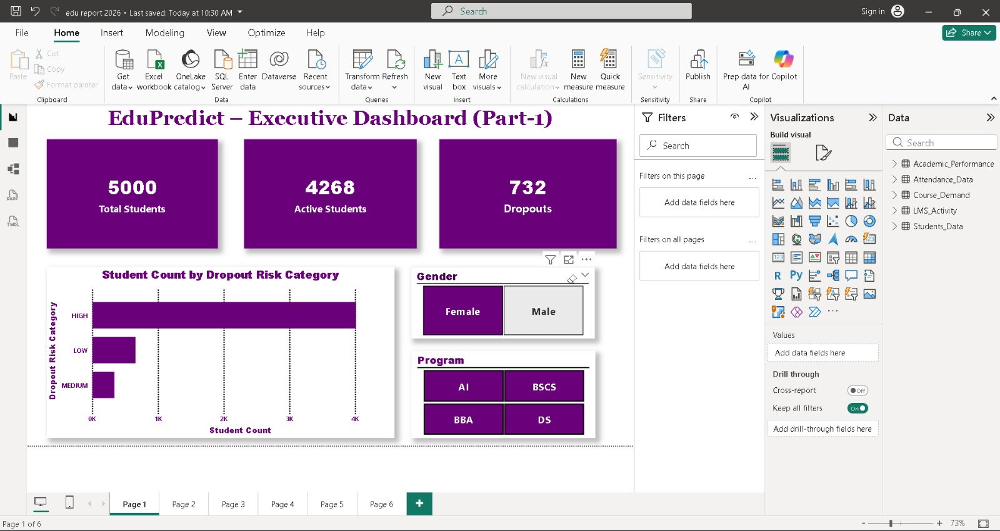
</p>

### 2. Executive Dashboard (Comparative Analysis & Breakdown)
Comparative evaluation of student demographics, academic success distributions, and departmental performance.
<p align="center">
  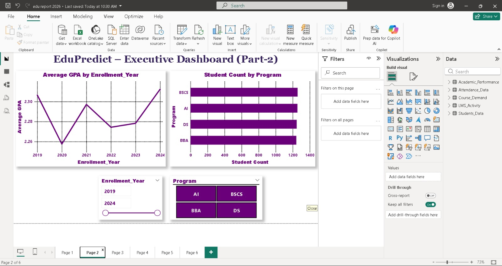
</p>

### 3. Student Academic Performance
Detailed GPA distributions, subject-wise scoring metrics, and pass-versus-fail ratios across diverse academic programs.
<p align="center">
  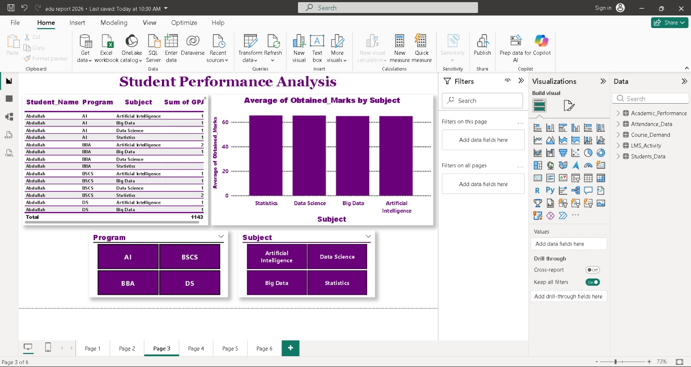
</p>

### 4. Attendance & Dropout Risk Prediction
Proactive identification of low-attendance patterns mapped directly against calculated dropout risk indices.
<p align="center">
  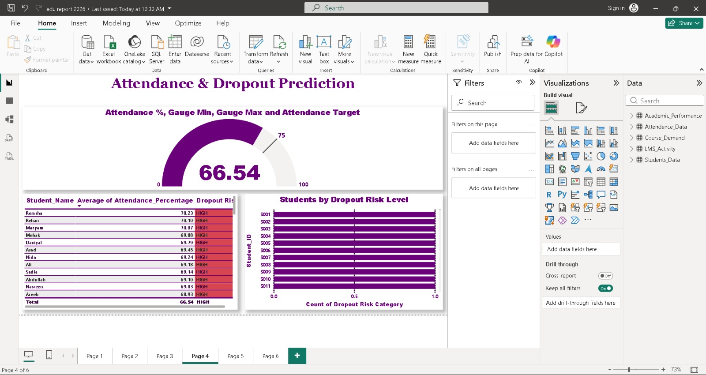
</p>

### 5. LMS Engagement & Digital Interaction
Telemetry analytics tracking login frequency, assignments completed, and quiz submission compliance.
<p align="center">
  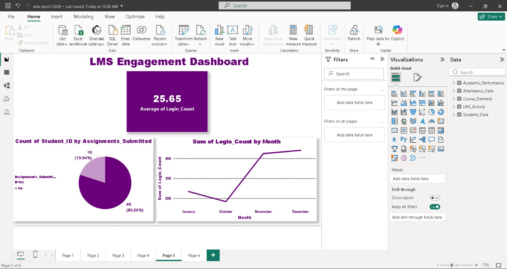
</p>

### 6. Course Demand & Enrollment Trends
Enrollment distribution per semester, identifying high-demand subjects to optimize classroom and faculty scheduling.
<p align="center">
  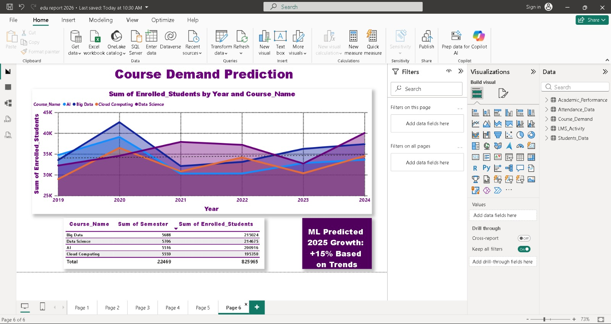
</p>

### 7. Star Schema & Data Model View
Visual architecture of the relationships connecting student dimensions, fact tables, and lookup tables in Power BI.
<p align="center">
  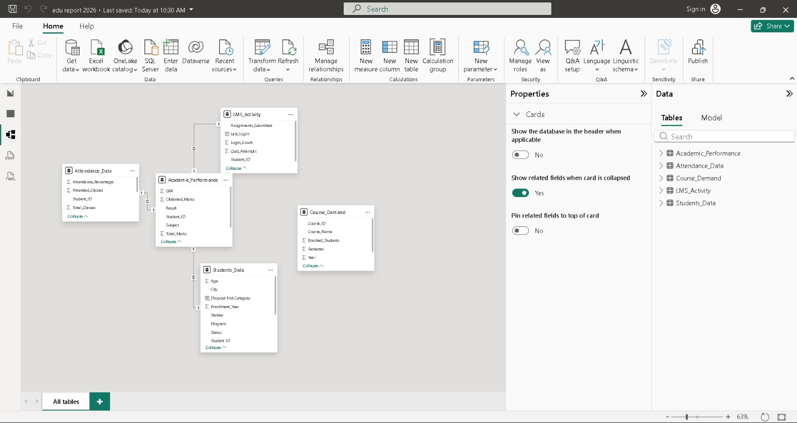
</p>

<details>
<summary><b>🔍 Click here to view raw data table views</b></summary>

| Academic Performance Table | Attendance Records Table |
| :---: | :---: |
| 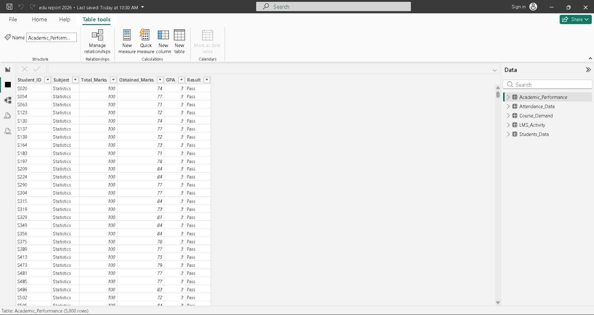 | 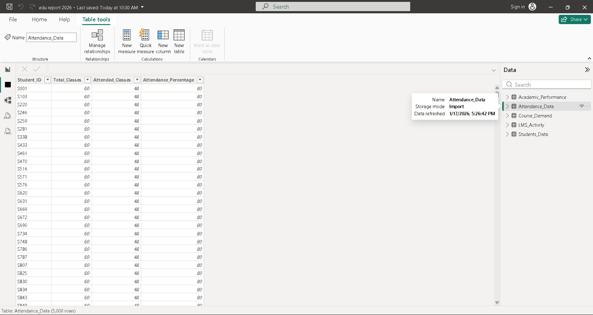 |

| Course Demand Table | LMS Activity Table |
| :---: | :---: |
| 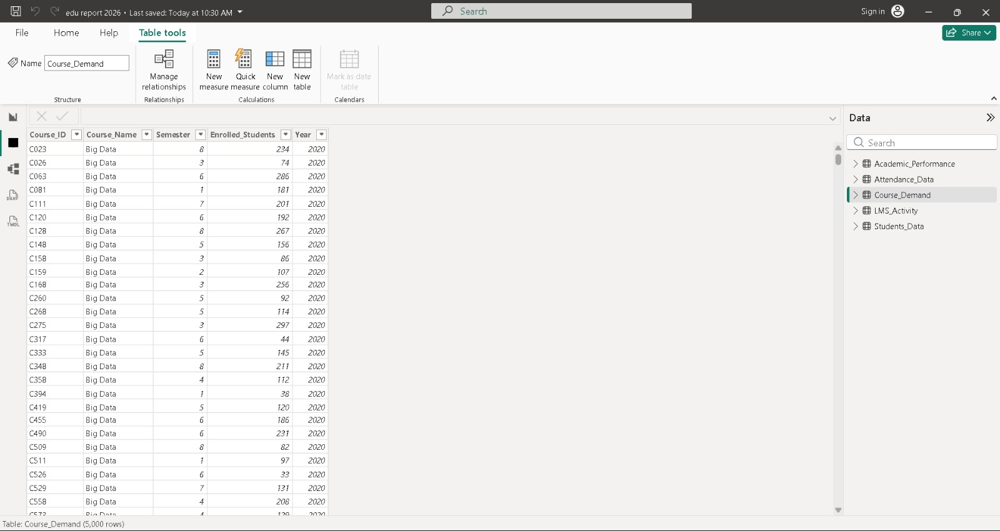 | 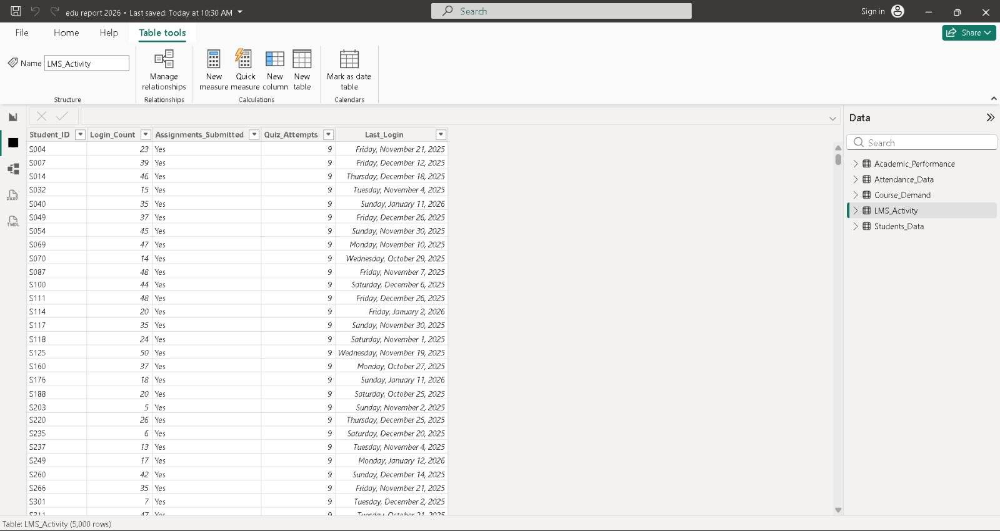 |

| Student Demographics Table |
| :---: |
| 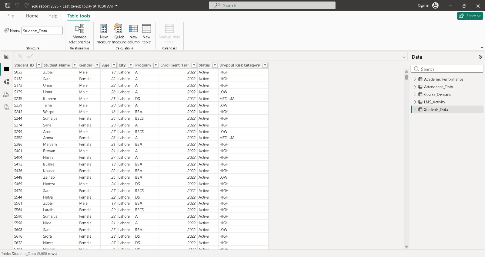 |

</details>

---

## 📁 Repository Structure

```text
Big Data - EduPredict/
│
├── assets/
│   ├── cover_banner.png                     # Master high-resolution project cover banner
│   └── screenshots/                         # High-fidelity dashboard captures & table views
│       ├── 01_executive_dashboard_part1.jpeg
│       ├── 02_executive_dashboard_part2.jpeg
│       ├── 03_student_performance_analysis.jpeg
│       ├── 04_attendance_dropout_prediction.jpeg
│       ├── 05_lms_engagement_dashboard.jpeg
│       ├── 06_course_demand_prediction.jpeg
│       ├── 07_data_model_relationships.jpeg
│       ├── 08_academic_performance_table.jpeg
│       ├── 09_attendance_data_table.jpeg
│       ├── 10_course_demand_table.jpeg
│       ├── 11_lms_activity_table.jpeg
│       └── 12_student_demographics_table.jpeg
│
├── dashboard/
│   └── EduPredict_Analytics.pbix            # Complete Power BI project file (Data model + visuals)
│
├── demo/
│   └── EduPredict_Walkthrough_Demo.mp4      # HD video walkthrough demonstration of the system
│
├── docs/
│   └── EduPredict_System_Documentation.docx # Complete technical report, DFDs, and functional specs
│
├── .gitignore                               # Standard repository ignore configuration
└── README.md                                # Project overview, architecture, and documentation
```

---

## 🛠️ Technology Stack & Tools

- **Business Intelligence & Reporting**: [Microsoft Power BI Desktop](https://powerbi.microsoft.com/)
- **Data Preparation & Validation**: Microsoft Excel / Power Query
- **Big Data Architecture**: Apache Hadoop, HDFS
- **Database & Query Engines**: MongoDB Compass, Apache Impala
- **Documentation & Design**: Microsoft Office Word, Canva

---

## 🚀 Getting Started

### Prerequisites

To explore and interact with the dashboards locally, you will need:
- [Microsoft Power BI Desktop](https://powerbi.microsoft.com/desktop/) (Free download, Windows 10/11)
- [Microsoft Word](https://www.microsoft.com/en/microsoft-365/word) or any docx-compatible viewer to view the full specification report.
- Standard media player (e.g. VLC or Windows Media Player) to view the project demo video.

### Running the Dashboard

1. Clone or download this repository:
   ```bash
   git clone https://github.com/<your-username>/Big-Data-EduPredict.git
   cd Big-Data-EduPredict
   ```
2. Navigate to the `dashboard/` directory.
3. Double-click `EduPredict_Analytics.pbix` to launch the report in **Power BI Desktop**.
4. Use the bottom navigation tabs to switch between the 6 analytical views.
5. Interact with slicers (Program, Academic Year, Gender, Subject) to drill down into cohort trends.

---

## 📋 Project Execution Timeline

| Task ID | Milestone / Task Description | Status |
| :--- | :--- | :---: |
| **T1** | Requirement Gathering & Problem Definition | ✅ Completed |
| **T2** | Identification & Collection of Multi-Source Data | ✅ Completed |
| **T3** | Data Preparation & Normalization in Excel | ✅ Completed |
| **T4** | Data Cleansing, Imputation & Validation | ✅ Completed |
| **T5** | Relational Table Structure Design | ✅ Completed |
| **T6** | Data Pipeline Ingestion into Power BI | ✅ Completed |
| **T7** | Data Modeling & Relationship Mapping | ✅ Completed |
| **T8** | Academic Performance Dashboard Build | ✅ Completed |
| **T9** | Attendance & LMS Engagement Dashboard Build | ✅ Completed |
| **T10** | Course Demand & Dropout Risk Analytical Views | ✅ Completed |
| **T11** | Interactive Slicers, KPI Gauges & Visual Optimization | ✅ Completed |
| **T12** | Comprehensive Dashboard & Functional Testing | ✅ Completed |
| **T13** | System Documentation, Video Recording & Final Review | ✅ Completed |

---

## 👥 Project Team & Contributors

This project was designed and developed as part of the **ADSE-II (Advanced Diploma in Software Engineering)** curriculum:

- **Muhammad Hammad** — *Lead Developer & Data Analyst* (Student ID: 1478294)
- **Muhammad Abdullah** — *Core Developer & BI Specialist* (Student ID: 1482263)
- **Ateeb Ahmed** — *Contributor* (Student ID: 1478517)
- **Muhammad Fahad** — *Contributor* (Student ID: 1487174)

---

## 📜 License

This project is developed for academic, educational, and portfolio demonstration purposes. All rights reserved by the project contributors.
